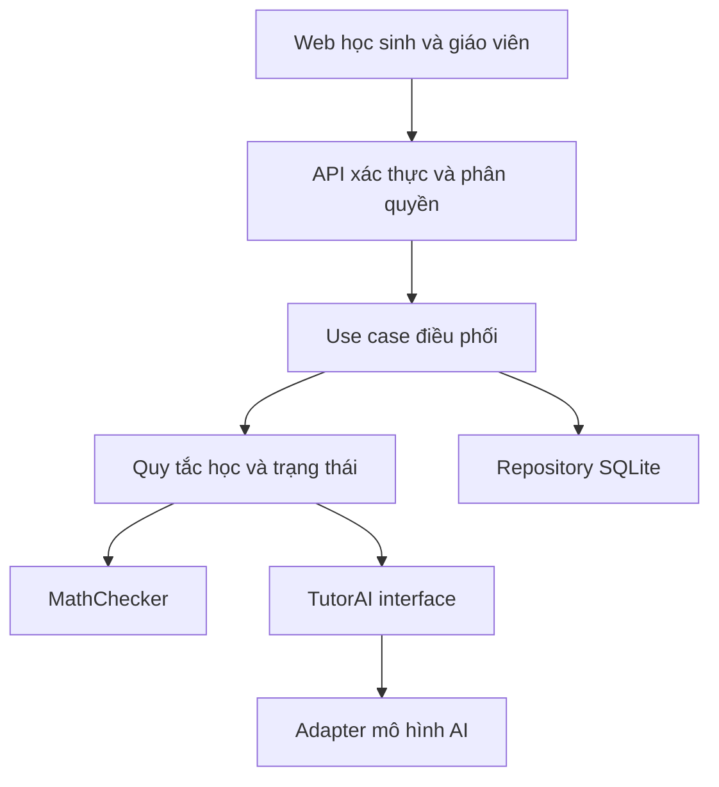
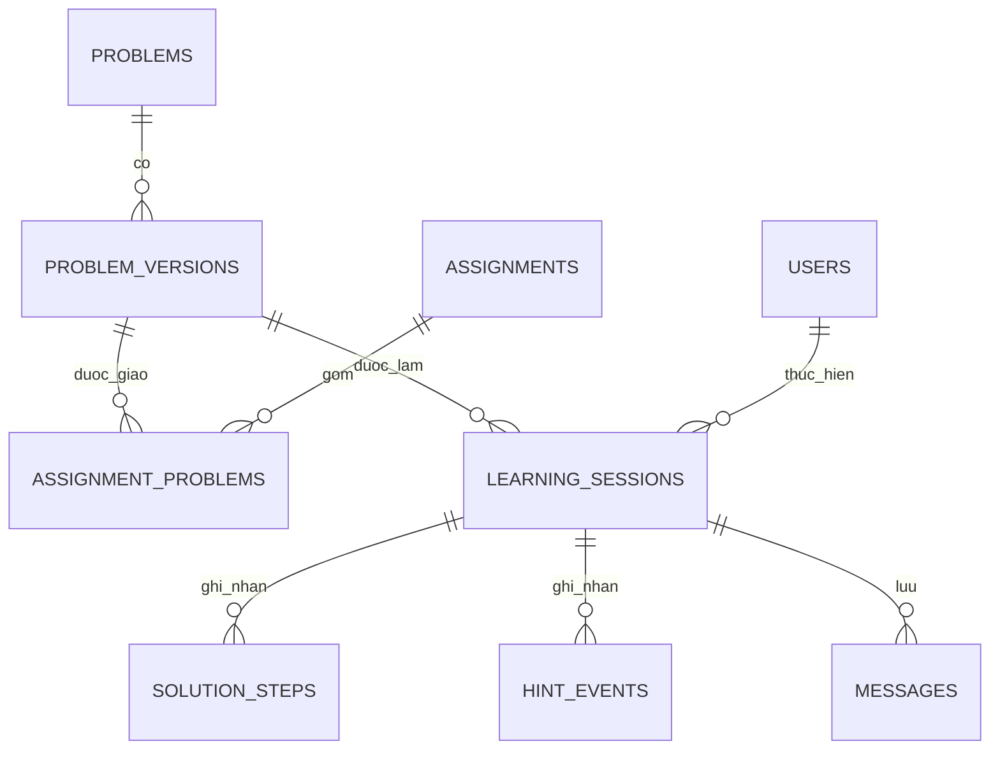
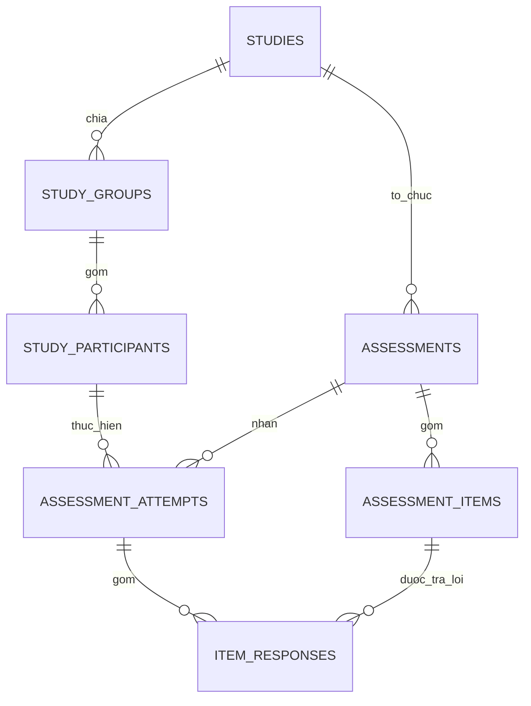
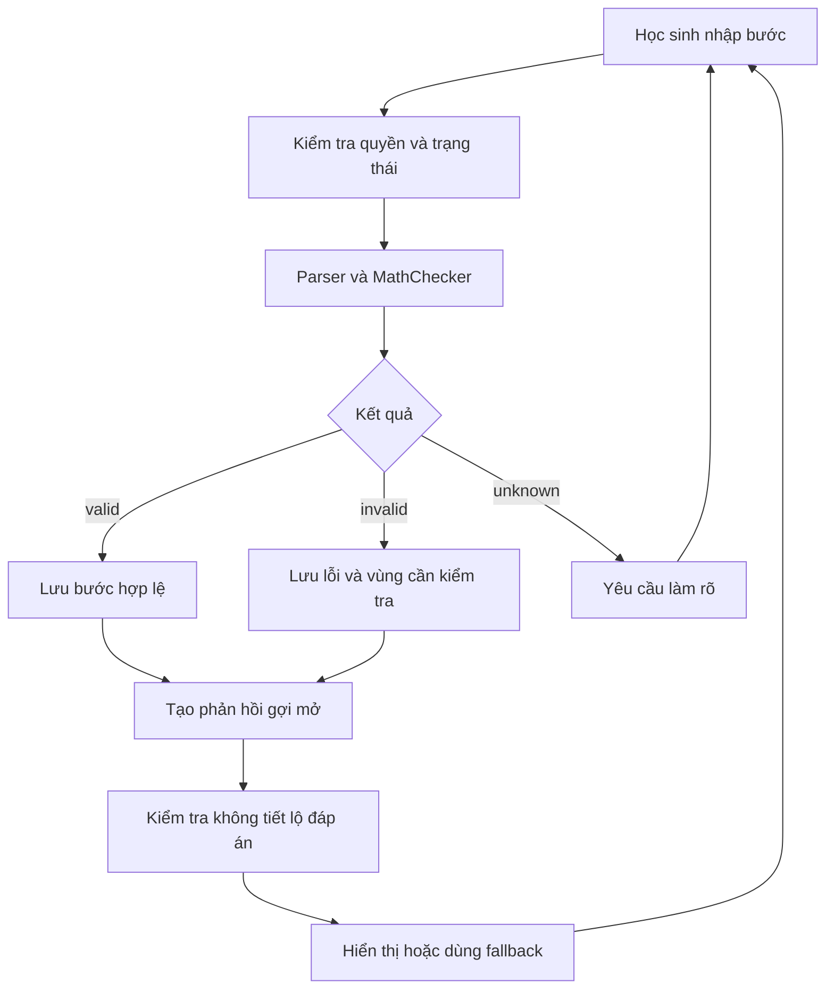

# Tài liệu bàn giao kỹ thuật Trợ lý AI học Toán THCS

**Tên đề tài:** Xây dựng và đánh giá trợ lý AI hỗ trợ học sinh THCS tự học môn Toán theo quy trình gợi mở từng bước.  
**Phiên bản tài liệu:** 1.0 — ngày 13/10/2026.  
**Đối tượng sử dụng:** Claude Code, lập trình viên, giáo viên Toán và nhóm nghiên cứu.  
**Mục tiêu bàn giao:** triển khai web từ bộ SQLite đã có, với quy trình học được kiểm soát và dữ liệu đủ phục vụ đánh giá trước/sau.

## Mục lục

1. Tổng quan và nguyên tắc cốt lõi
2. Vai trò và phân quyền
3. Kiến trúc phần mềm
4. Database schema SQLite
5. Luồng nghiệp vụ chính
6. Hợp đồng API và AI
7. Lộ trình thực thi bốn giai đoạn
8. Kiểm thử và nghiệm thu
9. Vận hành và đo lường nghiên cứu
10. Chỉ dẫn thực thi cho Claude Code

---

## 1. Tổng quan và nguyên tắc cốt lõi

### 1.1. Mục tiêu

- Hỗ trợ học sinh đọc đề, nhận diện kiến thức, đề xuất cách giải, thực hiện phép biến đổi và tự kiểm tra nghiệm.
- Phát triển khả năng giải thích, tự sửa lỗi và giải bài mới độc lập.
- Cho giáo viên quan sát quá trình học, thay vì chỉ thấy đáp án cuối.
- Thu thập dữ liệu phục vụ thực nghiệm: kết quả giải bài, chất lượng giải thích, số lượt hỗ trợ, thời gian hoạt động và năng lực sau học.

### 1.2. Triết lý sư phạm bắt buộc

**Không cung cấp đáp án trực tiếp hoặc lời giải hoàn chỉnh cho bài đang giao cho học sinh.** AI chỉ hỏi, nhắc kiến thức và gợi ý thao tác để học sinh tự thực hiện. Quy định áp dụng cả khi học sinh yêu cầu “bỏ qua hướng dẫn”, “cho đáp án” hoặc chèn chỉ dẫn thay đổi vai trò AI.

| Nguyên tắc | Hành vi phải thực hiện |
|---|---|
| Học sinh tự giải | Học sinh nhập phép biến đổi và giải thích |
| Gợi mở từng bước | Mỗi lượt tối đa một câu hỏi chính, phản hồi ngắn |
| Gợi ý tăng dần | Mức 1 định hướng; mức 2 nhắc quy tắc; mức 3 gợi thao tác, không tính hộ |
| Tôn trọng cách giải khác | Chấp nhận cách làm hợp lệ, không bắt trùng lời giải mẫu |
| Tách đáp án và hiểu bài | Đúng đáp án nhưng thiếu giải thích vẫn cần bổ sung |
| Không đoán lỗi | Đầu vào chưa hiểu trả `unknown`, yêu cầu làm rõ |
| Kiểm tra độc lập | Không AI, không gợi ý, không phản hồi đúng/sai trong lúc làm |
| Có giáo viên giám sát | Giáo viên duyệt bài, rubric và xử lý phản hồi bị báo lỗi |

Nếu học sinh tự đưa ra `x=6`, trợ lý có thể xác nhận sau khi kiểm tra, rồi yêu cầu giải thích hoặc thay nghiệm. Việc xác nhận kết quả học sinh đã nộp không đồng nghĩa tự tiết lộ đáp án. Kết quả/lời giải giáo viên chỉ được trả qua API có quyền chuyên môn.

### 1.3. Phạm vi MVP

| Trong phiên bản đầu | Để giai đoạn mở rộng |
|---|---|
| Web dùng trên máy tính và điện thoại | Ứng dụng native |
| Một khối lớp THCS, một chủ đề | Toàn bộ chương trình |
| Phương trình tuyến tính một ẩn có hệ số số học | Hình học chứng minh, phương trình chứa căn/mẫu theo biến |
| Đề từ ngân hàng giáo viên duyệt | Nhập đề tự do, ảnh đề, chữ viết tay |
| Nhập phương trình, thao tác, giải thích | Hội thoại giọng nói |
| Kiểm tra trước/sau, báo cáo và CSV | Cá nhân hóa tự động, trò chơi hóa, RAG diện rộng |

Các dạng ban đầu: `ax+b=c`, `ax+b=cx+d`, phương trình có ngoặc và phép thu gọn tuyến tính. Kiểm thử phải có trường hợp một nghiệm, vô nghiệm và vô số nghiệm. Không phát biểu rằng bộ kiểm tra giải được mọi bài Toán THCS.

### 1.4. Tài sản đã có và phần chưa triển khai

Nguồn đối chiếu: `Database_Tro_ly_Toan_SQLite.zip`, gồm `schema.sql`, `seed.sql`, `db.py`, `init_db.py`, `session_repository.py`, `queries.sql`, `export_results.py`, `tests.py`, `DATA_DICTIONARY.md`, `data/math_tutor_demo.db` và README.

| Đã có trong gói SQLite | Cần lập trình tiếp |
|---|---|
| 26 bảng, 3 view, index và trigger | Dịch vụ xác thực và phân quyền API |
| Database giả lập: 5 người dùng, 3 bài | MathChecker và bộ quản lý trạng thái |
| Repository lưu bước nguyên tử | Đối thoại AI có kiểm soát |
| Chống trùng request, kiểm tra version | API giáo viên/nghiên cứu và giao diện |
| Script xuất dữ liệu theo mã tham gia | Rubric, tính thời gian hoạt động, audit |
| Bộ 18 kiểm thử database/repository đã có | Kiểm thử tích hợp và end-to-end |

Không coi dữ liệu seed là dữ liệu thực nghiệm. `ai-config-demo` chỉ là cấu hình giữ chỗ. Gói database chưa chứa AI thực, xác thực hay kiểm tra toán.

## 2. Vai trò và phân quyền

### 2.1. Bốn vai trò chính

| Vai trò | Quyền được cấp | Phạm vi và giới hạn |
|---|---|---|
| Học sinh `student` | Xem bài, tạo phiên, nộp bước, xin gợi ý, kiểm tra nghiệm, làm kiểm tra, xem tiến bộ, báo phản hồi sai | Chỉ dữ liệu của mình và bài thuộc lớp; không đọc lời giải/gợi ý nội bộ |
| Giáo viên `teacher` | Quản lý lớp, soạn/duyệt bài, giao bài, xem lịch sử, chấm giải thích, xử lý phản hồi | Lớp mình phụ trách; đánh giá nghiên cứu cần thêm phạm vi đợt được phân công |
| Người nghiên cứu `researcher` | Quản lý đợt, nhóm, người tham gia, đề trước/sau, báo cáo và xuất dữ liệu | Phải có bản ghi `study_researchers`; báo cáo mặc định dùng `participant_code` |
| Quản trị viên `admin` | Cấp/thu hồi vai trò, khóa tài khoản, cấu hình AI, theo dõi lỗi, backup | Không mặc nhiên được sửa điểm hay xuất dữ liệu nghiên cứu |

Một người có thể có nhiều vai trò qua `user_roles`. AI là thành phần hệ thống, không phải vai trò tài khoản.

### 2.2. Quy tắc kiểm tra quyền

- Lấy `actor_id` từ token đã xác thực và ánh xạ `users.auth_subject`; không lấy từ body do trình duyệt gửi.
- Kiểm tra `users.status='active'` và vai trò cho mỗi yêu cầu có quyền nghiệp vụ.
- Phiên học: kiểm tra `learning_sessions.student_id` bằng người gọi.
- Lớp: kiểm tra `classes.teacher_id` bằng giáo viên; việc thêm học sinh kiểm tra vai trò student.
- Đợt: kiểm tra vai trò researcher và cặp `(study_id, researcher_id)` tồn tại.
- Chính sách chấm nghiên cứu trong MVP: giáo viên phải đồng thời được cấp researcher và được thêm vào đợt. Schema chưa có bảng phân công người chấm riêng.
- Người nghiên cứu chỉ xem dữ liệu định danh khi thực hiện tuyển/chia nhóm trong phạm vi được phép; endpoint xuất CSV loại thông tin định danh.
- Người soạn chỉ sửa bản nháp của mình; giáo viên có quyền duyệt theo chính sách nội dung. Sau duyệt tạo phiên bản mới để sửa.
- Tất cả endpoint kiểm tra quyền ở server; ẩn nút trên giao diện không thay thế phân quyền.

SQLite không có RLS/tài khoản database kiểu PostgreSQL. Các view không tự kiểm soát quyền. Không giữ thiết kế Supabase PostgreSQL của bản đề xuất ban đầu song song với SQLite; nếu dùng nhà cung cấp xác thực bên ngoài, chỉ dùng cho đăng nhập và ánh xạ `auth_subject`.

## 3. Kiến trúc phần mềm

### 3.1. Kiến trúc phân lớp và modular monolith

Một backend gồm các mô-đun độc lập về trách nhiệm, dùng chung SQLite. Chưa tách microservice.



| Thành phần | Công nghệ/chức năng |
|---|---|
| Frontend | Next.js, TypeScript, Tailwind CSS, KaTeX |
| Backend | Python FastAPI, request/response schema |
| Kiểm tra toán | Parser giới hạn + SymPy, adapter `MathChecker` |
| Nghiệp vụ | `LearningStateMachine`, `HintPolicy`, `SessionService`, `AssessmentService` |
| AI | `TutorAI` interface và adapter một nhà cung cấp; hỗ trợ mock/fallback |
| Dữ liệu | SQLite, repository, migration có version |
| Báo cáo | Truy vấn có phạm vi quyền, xuất CSV |

Khóa phiên bản dependencies khi triển khai. Không giả định API/SDK hiện hành từ đoạn ví dụ cũ; đối chiếu tài liệu chính thức của phiên bản được chọn.

### 3.2. Quyền quyết định

| Quyết định | Nơi thực hiện |
|---|---|
| Phép biến đổi và nghiệm có đúng không | MathChecker |
| Được chuyển trạng thái không | LearningStateMachine |
| Mức gợi ý nào được phép | HintPolicy |
| Diễn đạt câu hỏi gợi mở | AI hoặc phản hồi mẫu |
| Điểm nghiên cứu chính thức | Rubric và giáo viên/người chấm được cấp quyền |

Không để AI ghi database trực tiếp hoặc tự thay điểm/trạng thái.

### 3.3. Cấu trúc mã nguồn đề xuất

| Đường dẫn | Trách nhiệm |
|---|---|
| `web/src/app/` | Trang theo vai trò |
| `web/src/features/` | Học tập, lớp học, nghiên cứu |
| `web/src/components/` | Thành phần giao diện |
| `web/src/lib/` | API client và tiện ích |
| `api/app/api/` | Routes, schemas, middleware |
| `api/app/application/` | Các use case điều phối |
| `api/app/domain/` | Entity, interface, quy tắc nghiệp vụ |
| `api/app/infrastructure/` | SQLite, SymPy, AI, xác thực |
| `api/tests/` | Unit và integration |
| `database/` | Gói SQLite, migration, seed |
| `content/` | Rubric, prompt, gợi ý và bài đã duyệt |
| `docs/` | Tài liệu bàn giao và quyết định kiến trúc |

Không gom tất cả nghiệp vụ vào một `AIService`. Domain không phụ thuộc SDK của nhà cung cấp AI.

## 4. Database schema SQLite

### 4.1. Tóm tắt đủ 26 bảng

Tên bảng dưới đây khớp schema version 1. Chia theo bốn nhóm yêu cầu, cộng một bảng kỹ thuật; không tạo thêm bảng ngầm.

#### A. Tài khoản và phân quyền — 5 bảng

| STT | Bảng | Dữ liệu và quan hệ chính |
|---|---|---|
| 1 | `users` | ID, auth_subject, tên hiển thị, trạng thái |
| 2 | `roles` | student, teacher, researcher, admin |
| 3 | `user_roles` | PK ghép user_id + role_code |
| 4 | `classes` | Lớp, teacher_id, năm học |
| 5 | `class_members` | PK ghép class_id + student_id |

#### B. Học tập và bài tập — 6 bảng

| STT | Bảng | Dữ liệu và quan hệ chính |
|---|---|---|
| 6 | `topics` | Chủ đề và lớp 6–9 |
| 7 | `problems` | Định danh bài, chủ đề, tác giả |
| 8 | `problem_versions` | PK problem_id + version; đề, math_spec, lời giải nội bộ, hints, mức khó, trạng thái duyệt |
| 9 | `assignments` | Lớp, người giao, tiêu đề, learning_mode, hạn |
| 10 | `assignment_problems` | Các bài/phiên bản của lần giao và thứ tự |
| 11 | `learning_sessions` | Học sinh, bài/phiên bản, assignment tùy chọn, mode, state, version, thời điểm |

#### C. Tương tác và gợi ý AI — 6 bảng

| STT | Bảng | Dữ liệu và quan hệ chính |
|---|---|---|
| 12 | `ai_configs` | Provider, model, prompt_version, parameters; không lưu API key |
| 13 | `solution_steps` | Các lần thử; phương trình trước/sau, thao tác, giải thích, math_status, error_code, request_id |
| 14 | `hint_events` | Phiên, step tùy chọn, mức 1–3, trigger, nội dung |
| 15 | `messages` | Lịch sử đối thoại và cấu hình AI |
| 16 | `activity_events` | start, pause, resume, heartbeat, submit, finish |
| 17 | `feedback_reports` | Phản hồi bị báo lỗi, người báo, trạng thái và kết quả xử lý |

#### D. Thực nghiệm và đánh giá — 8 bảng

| STT | Bảng | Dữ liệu và quan hệ chính |
|---|---|---|
| 18 | `studies` | Đợt nghiên cứu, thời gian |
| 19 | `study_researchers` | Người được cấp quyền cho đợt |
| 20 | `study_groups` | Nhóm ai_guided hoặc comparison |
| 21 | `study_participants` | Học sinh, nhóm, study_id, participant_code |
| 22 | `assessments` | Đề pre/post/retention, rubric_version |
| 23 | `assessment_items` | Bài/phiên bản, thứ tự, điểm tối đa lời giải và giải thích |
| 24 | `assessment_attempts` | Lượt làm theo người tham gia, đề, đợt, thời điểm nộp |
| 25 | `item_responses` | Lời giải, giải thích, điểm thành phần, người chấm |

#### E. Kỹ thuật — 1 bảng

| STT | Bảng | Trách nhiệm |
|---|---|---|
| 26 | `schema_migrations` | Ghi nhận phiên bản migration; hiện có version 1 |

Tổng: **5 + 6 + 6 + 8 + 1 = 26 bảng**.

### 4.2. Các quan hệ trọng tâm





Khóa ngoại ghép đảm bảo phiên học dùng đúng bài được giao; gợi ý có step phải thuộc cùng phiên; người làm và đề phải cùng đợt; item và attempt phải cùng assessment.

### 4.3. Quy ước dữ liệu

| Thuộc tính | Quy ước |
|---|---|
| ID | TEXT, backend sinh UUID; ID dễ đọc trong seed chỉ để minh họa |
| Thời gian | ISO 8601 UTC; UI hiển thị theo múi giờ địa phương |
| JSON | TEXT, CHECK json_valid; backend kiểm tra thêm schema và độ dài |
| Điểm | REAL, không âm, không vượt tối đa; chuẩn hóa làm tròn |
| learning_mode | guided / practice / independent |
| math_status | valid / invalid / unknown |
| hint trigger | student_request / system_offer |
| phase | pre / post / retention |

`math_spec` tối thiểu chứa `variable`, `domain`, `lhs`, `rhs`. Không trả `teacher_solution` hoặc hints nội bộ cho client học sinh.

### 4.4. Ràng buộc đã có và trách nhiệm còn lại

| Ràng buộc | Đã có ở SQLite/repository | Backend phải bổ sung |
|---|---|---|
| Khóa ngoại | FK và FK ghép | Bật foreign_keys trên mọi kết nối |
| Bài đã duyệt bất biến | Chặn UPDATE/DELETE bản approved | Duyệt đúng quyền; sửa bằng version mới |
| Bài giao/kiểm tra được duyệt | Trigger kiểm tra khi thêm | Kiểm tra quyền và thời hạn |
| Mở phiên bài giao | Đúng thành viên, bài/phiên bản và mode | Token, tài khoản active, vai trò |
| Chặn gợi ý độc lập | Chặn INSERT hint khi independent, INDEPENDENT_PRACTICE hoặc COMPLETED | Chặn endpoint, đối thoại và rò rỉ đáp án; assessment riêng không đi qua session |
| Chống bước trùng | UNIQUE(session_id, step_index/request_id) | Retry cùng payload; request cũ khác payload trả conflict |
| Đồng thời cập nhật | Repository dùng BEGIN IMMEDIATE và version | Ánh xạ conflict HTTP, cập nhật version cho mọi mutation phiên |
| Lịch sử giải/gợi ý | Chặn UPDATE | Không cung cấp DELETE lịch sử cho người dùng |
| Một nhóm mỗi đợt | UNIQUE(study_id, student_id) | Kiểm tra đối tượng đủ điều kiện tham gia |
| Điểm hợp lệ | CHECK và trigger giới hạn | Rubric và quyền chấm, khóa bài nộp |
| JSON hợp lệ | json_valid | Cấu trúc semantic, parser và giới hạn tài nguyên |
| Chuyển trạng thái | CHECK danh sách tên state | State machine kiểm tra trình tự, không chỉ tên |

Trigger không chống người có quyền truy cập trực tiếp file database. Các quy tắc về vai trò, state machine và nội dung AI chưa được triển khai trong gói hiện tại.

### 4.5. Ba view báo cáo

| View | Nội dung |
|---|---|
| `session_summary` | Số lần thử, bước sai, tổng gợi ý, số gợi ý được yêu cầu, mức cao nhất |
| `assessment_totals` | Số item kỳ vọng/đã trả lời/đã chấm; total_score chỉ có sau nộp và chấm đủ |
| `research_results` | participant_code, nhóm, phase, attempt_id và kết quả |

Không JOIN nhiều bảng con rồi COUNT trực tiếp làm nhân số bước/gợi ý. View hiện dùng tổng hợp riêng. `total_score=NULL` nghĩa chưa đủ điều kiện có điểm, không phải 0.

### 4.6. Khoảng trống cần xử lý bằng migration hoặc chính sách

- Chưa có quan hệ trực tiếp từ session học đến bài luyện độc lập và study. Nếu cần đo chuyển giao theo từng phiên, thêm `parent_session_id` nullable tham chiếu learning_sessions và `study_id` nullable, kèm kiểm tra cùng học sinh và đối tượng tham gia. Đây là migration mới, không phải cột đang có.
- Gói rubric chỉ lưu `rubric_version`; cần file rubric bất biến theo version trong `content/`, không thay nội dung dưới cùng version.
- Chưa có bảng audit và lưu kết quả HTTP idempotent. Nếu cần lưu phản hồi đầy đủ qua retry/AI, thêm bảng request_results hoặc thiết kế thao tác phản hồi riêng có khóa chống trùng.
- Gợi ý hiện chưa có request_id. Cần migration thêm request_id/UNIQUE hoặc dùng request_results để tránh một lần bấm bị tính hai lần khi retry.
- Cần bảo vệ danh sách item/điểm tối đa khi đề đã bắt đầu có lượt làm; schema hiện chặn UPDATE item nhưng chưa tự khóa mọi INSERT/DELETE theo thời điểm.
- Không sửa schema version 1 để áp vào database đã có. Viết migration tiếp theo, backup và kiểm thử bảo toàn dữ liệu.

## 5. Luồng nghiệp vụ chính

### 5.1. State machine học có hướng dẫn

| State | Nhiệm vụ | Điều kiện chuyển tiếp |
|---|---|---|
| READ_PROBLEM | Đọc đề, nêu yêu cầu | Xác định được mục tiêu |
| IDENTIFY_KNOWLEDGE | Nêu kiến thức | Có nhận diện phù hợp hoặc đã được hỗ trợ |
| PROPOSE_PLAN | Nêu hướng giải | Thao tác dự kiến hợp lệ |
| SOLVE_STEP | Nhập bước và giải thích | Tìm nghiệm/tập nghiệm với các bước hợp lệ |
| VERIFY_RESULT | Kiểm tra trên đề ban đầu | Kiểm tra thành công |
| INDEPENDENT_PRACTICE | Đánh dấu giai đoạn luyện độc lập | Bài mới được nộp |
| COMPLETED | Tổng kết | completed_at có giá trị |

Ở MVP, luyện bài tương tự tạo một **session mới** với mode independent và đề khác đã duyệt; session gốc ở INDEPENDENT_PRACTICE để không nhận thêm gợi ý. Không thay problem_id của session gốc. Muốn tự động liên kết chắc chắn giữa hai phiên, thực hiện migration parent_session_id ở giai đoạn 1.

Session independent không sử dụng đầy đủ chuỗi gợi mở; service tạo trạng thái nhận bài phù hợp và tuyệt đối không trả phản hồi trước nộp. Assessment trước/sau đi theo bảng assessment_attempts, không giả lập là guided session.

### 5.2. Luồng giải bài tương tác

1. Học sinh đăng nhập, chọn bài được giao.
2. Backend kiểm tra quyền, mode, phiên bản bài và tạo/khôi phục phiên.
3. Học sinh đọc đề, nêu kiến thức và hướng giải.
4. Nhập `submitted_equation`, `operation`, `operation_value`, `explanation`.
5. Server đọc phương trình đang có từ lịch sử: bước valid gần nhất hoặc math_spec ban đầu. Bước invalid không trở thành phương trình nền.
6. Parser giới hạn phân tích biểu thức; MathChecker kiểm tra thao tác, tính toán và tương đương.
7. valid: ghi nhận, hỏi bước tiếp; invalid: chỉ ra vùng cần xem lại; unknown: yêu cầu làm rõ.
8. Khi học sinh cần, cung cấp gợi ý mức cho phép và ghi hint_event.
9. Sau khi tìm nghiệm, yêu cầu tự thay nghiệm hoặc kiểm chứng kết luận vô nghiệm/vô số nghiệm.
10. Tạo bài luyện độc lập, nộp và tổng kết.



### 5.3. Ví dụ chuẩn

Đề: `2x + 5 = 17`.

| Lượt | Học sinh | Hệ thống |
|---|---|---|
| 1 | Muốn tìm x | Hỏi thao tác để giữ lại 2x |
| 2 | Trừ 5 hai vế, nhập 2x=22 | invalid; yêu cầu kiểm tra 17−5 |
| 3 | Sửa thành 2x=12 | valid; hỏi bước tiếp theo |
| 4 | Chia hai vế cho 2, nhập x=6 | valid; yêu cầu thay nghiệm |
| 5 | 2×6+5=17 | Xác nhận kiểm tra, mở bài tương tự |

### 5.4. Kiểm tra Toán

- Parser chỉ cho phép biến x, số, dấu ngoặc, phép toán trong phạm vi hỗ trợ và một dấu bằng.
- Không đưa trực tiếp input vào eval hoặc parser có thể thực thi mã.
- Kiểm tra phép cộng/trừ hai vế; nhân/chia phải xét điều kiện, không cho chia 0.
- Kiểm tra thao tác đã chọn so với phương trình học sinh nhập. Có cùng tập nghiệm chưa đủ chứng minh thao tác mô tả đúng.
- Sử dụng số chính xác/phân số để tránh lỗi so sánh floating point không cần thiết.
- Phương trình ngoài phạm vi trả unknown; không gán invalid.
- Với vô nghiệm/vô số nghiệm, không yêu cầu nhập một nghiệm số như bài có một nghiệm.
- MathChecker trả lỗi có mã, không dựa vào phán đoán tự do của LLM để chấm đúng/sai.

### 5.5. Luồng kiểm tra độc lập

1. Backend xác nhận học sinh thuộc đợt và đề được phép làm.
2. Tạo assessment_attempt và chỉ trả đề từ phiên bản cố định.
3. Học sinh nhập bài làm; có thể lưu nháp item_response, không có điểm/nhận xét AI.
4. Backend từ chối yêu cầu chat, hint hoặc kiểm tra đúng/sai cho bài đang kiểm tra, kể cả gọi API trực tiếp.
5. Khi nộp, kiểm tra đủ item theo chính sách, cập nhật submitted_at và khóa nội dung bài làm.
6. Chấm sau nộp: bộ toán có thể đề xuất, giáo viên xác nhận điểm và rubric giải thích.
7. Công bố kết quả theo chính sách đề; không tự hiển thị lời giải toàn bộ cho học sinh.

Không chặn chỉ bằng việc ẩn nút. Trình duyệt không được nhận teacher_solution/hints/đáp án rồi tự giấu.

### 5.6. Thực nghiệm và xuất dữ liệu

1. Tạo study và cấp study_researchers.
2. Tạo nhóm ai_guided/comparison, phân người tham gia, sinh participant_code duy nhất trong đợt.
3. Tạo pre/post và retention nếu cần, cố định bài và rubric.
4. Thực hiện kiểm tra trước không AI; luyện theo điều kiện nhóm với thời lượng tương đương; kiểm tra sau không AI.
5. Chấm cùng rubric; khi khả thi người chấm không biết nhóm.
6. Báo cáo theo mã tham gia; không tự suy ra quan hệ nhân quả chỉ từ điểm sau.
7. Xuất CSV theo allowlist: participant_code, condition, phase, attempt_id, total_score, expected_items, answered_items, graded_items.
8. Bổ sung số gợi ý/thời gian chỉ khi liên kết study-session đã được xác định chắc chắn.

`participant_code` là **giả danh** vì database vẫn có ánh xạ student_id. Báo cáo thường gọi là ẩn danh theo mã, nhưng không xuất tên, auth_subject, student_id, bảng ánh xạ hoặc văn bản tự do có thể chứa định danh. Script CLI hiện là tiện ích quản trị local; API export phải kiểm tra quyền lại.

## 6. Hợp đồng API và AI

### 6.1. API tối thiểu

| Method/path | Use case | Quyền |
|---|---|---|
| GET /me | Hồ sơ và vai trò | Đã xác thực |
| GET /assignments | Bài được giao | Student đúng lớp |
| POST /sessions | Tạo phiên | Student đủ quyền |
| GET /sessions/{id} | Khôi phục phiên | Chủ sở hữu hoặc teacher đúng lớp |
| POST /sessions/{id}/knowledge | Nộp nhận diện kiến thức | Chủ sở hữu |
| POST /sessions/{id}/plan | Nộp hướng giải | Chủ sở hữu |
| POST /sessions/{id}/steps | Nộp bước | Chủ sở hữu, state phù hợp |
| POST /sessions/{id}/hints | Xin gợi ý | Chủ sở hữu, mode cho phép |
| POST /sessions/{id}/verify | Kiểm tra nghiệm | Chủ sở hữu, state phù hợp |
| POST /sessions/{id}/submit | Nộp luyện độc lập | Chủ sở hữu |
| POST /feedback-reports | Báo phản hồi sai | Người có quyền xem message |
| POST /classes | Tạo lớp | Teacher |
| POST /classes/{id}/members | Thêm học sinh | Teacher phụ trách |
| POST /problems; POST /problems/{id}/versions | Soạn bài | Teacher |
| POST /problems/{id}/versions/{v}/approve | Duyệt | Teacher có quyền |
| POST /assignments | Giao bài | Teacher phụ trách |
| GET /classes/{id}/report | Theo dõi lớp | Teacher phụ trách |
| POST /studies; POST /studies/{id}/groups | Tạo đợt/nhóm | Researcher có phạm vi |
| POST /studies/{id}/participants | Thêm người tham gia | Researcher của đợt |
| POST /studies/{id}/assessments | Tạo kiểm tra | Researcher của đợt |
| POST /assessments/{id}/attempts | Bắt đầu kiểm tra | Participant đúng đợt |
| PUT /attempts/{id}/items/{item_id} | Lưu bài chưa nộp | Chủ sở hữu |
| POST /attempts/{id}/submit | Nộp | Chủ sở hữu |
| PATCH /responses/{id}/grade | Chấm sau nộp | Teacher + phạm vi đợt |
| GET /studies/{id}/export | CSV giả danh | Researcher của đợt |
| POST /admin/ai-configs | Tạo config mới | Admin |

API error thống nhất: 401 chưa xác thực, 403 không đủ quyền, 404 không tồn tại/không tiết lộ tài nguyên, 409 version/state/request conflict, 422 input không đúng schema. Kết quả toán unknown là kết quả nghiệp vụ, không phải lỗi server.

### 6.2. Payload nộp bước

```json
{
  "request_id": "UUID-mot-lan-gui",
  "expected_version": 2,
  "submitted_equation": "x=6",
  "operation": "divide_both_sides",
  "operation_value": "2",
  "explanation": "Em chia cả hai vế cho 2"
}
```

Client không gửi actor_id, math_status, điểm, step_index hoặc phương trình nền làm nguồn tin cậy. Repository mẫu nhận previous_equation/math_status vì là hàm nội bộ; service phải tự xác định trước khi gọi.

```json
{
  "step_id": "UUID",
  "session_version": 3,
  "math_status": "valid",
  "state": "VERIFY_RESULT",
  "feedback": "Bước biến đổi này đúng.",
  "question": "Em hãy thay kết quả của mình vào phương trình ban đầu để kiểm tra.",
  "hint_level": 0
}
```

hint_level=0 trong response nghĩa chưa cấp gợi ý; hint_events chỉ ghi 1–3, không tạo event mức 0.

### 6.3. Giao dịch và retry

- Tính toán kiểm tra ngoài giao dịch ghi; khi lưu, kiểm tra version lại bằng giao dịch ngắn.
- Gói hiện chỉ tăng version khi thêm step. Service mới phải tăng version cho thay đổi state và các mutation có ảnh hưởng tiến trình để không dùng dữ liệu cũ.
- Lưu step trước; gọi AI sau commit. Không giữ khóa SQLite trong lúc chờ mạng.
- Nếu AI lỗi, trả phản hồi mẫu dựa trên error_code và state. Lưu message riêng, kiểm tra context/version trước khi gắn phản hồi.
- Cùng request_id và cùng payload không tạo bước mới. Repository hiện trả step cũ, chưa lưu response HTTP/AI; thiết kế kết quả retry ổn định ở application hoặc migration request_results.
- Nếu request_id cũ nhưng nội dung khác, trả 409. UI giữ cùng request_id khi retry một thao tác, tạo ID mới khi học sinh sửa nội dung.

### 6.4. Hợp đồng TutorAI

Input nội bộ: đề/kiến thức mục tiêu, state, câu trả lời học sinh, kết quả MathChecker, error_code, mức gợi ý được phép và lịch sử ngắn cần thiết. Không gửi thông tin định danh không cần thiết.

Output có schema:

```json
{
  "feedback": "Em hãy kiểm tra lại phép tính ở vế phải.",
  "question": "17 trừ 5 bằng bao nhiêu?",
  "hint_level": 1,
  "needs_teacher_review": false
}
```

Schema đúng không chứng minh nội dung đúng. Backend kiểm tra phản hồi không đưa đáp án, không trái MathChecker, không vượt mức hỗ trợ và không thay state/điểm. Nếu không chắc, dùng fallback đã duyệt. Không bảo đảm quy tắc “không đáp án” chỉ bằng prompt hoặc regex đơn giản.

**Chính sách lựa chọn gợi ý:** mặc định mức 1; chỉ tăng sau yêu cầu rõ hoặc khó khăn lặp lại; sau mức 3 vẫn khó thì đưa bài nền đơn giản hơn/chuyển giáo viên. Nút xin gợi ý là sự kiện riêng; không tính mọi tin nhắn AI là hỗ trợ.

## 7. Lộ trình thực thi bốn giai đoạn

Thực hiện tuần tự. Mỗi giai đoạn có mã chạy được, kiểm thử và báo cáo nghiệm thu; không xây UI trước rồi bỏ qua quy tắc nghiệp vụ.

### Giai đoạn 1 — Database và Repository

**Mục tiêu:** dùng bộ SQLite có sẵn làm nền dữ liệu đáng tin cậy.

**Công việc:**

1. Giải nén gói database vào `database/`; đọc schema, README, dictionary và tests.
2. Chạy 18 kiểm thử trên database tạm; ghi lại baseline, không sửa seed để che lỗi.
3. Tích hợp connection factory bật foreign_keys/busy_timeout; bật WAL lúc khởi tạo.
4. Viết repository cho người dùng, lớp, nội dung, assignment, session, hint, assessment và report.
5. Chuẩn hóa transaction, idempotency và optimistic version.
6. Thêm migration có kiểm thử cho liên kết luyện độc lập/study nếu triển khai đo theo phiên; hint request_id và audit/request_results theo thiết kế chọn.
7. Bổ sung khóa nội dung assessment sau mở lượt làm; ngăn chỉnh bài đã nộp ngoài chấm điểm.
8. Viết migration runner; init_db.py hiện chỉ tạo mới, không nâng cấp database.

**Đầu ra:** database và repository tích hợp, migration, dữ liệu demo, tests và lệnh chạy.

**Nghiệm thu:**

- [ ] integrity_check=ok, foreign_key_check rỗng.
- [ ] Chạy lại cùng request không tăng số bước.
- [ ] Conflict version không ghi một phần.
- [ ] Hint độc lập bị chặn; approved version không sửa được.
- [ ] Nâng migration từ dữ liệu cũ giữ nguyên lịch sử và điểm.
- [ ] Không ghi đè database đang có; backup/restore kiểm tra được.

### Giai đoạn 2 — MathChecker và quy trình sư phạm

**Mục tiêu:** hoàn thành một phiên học bằng phản hồi mẫu, chưa cần AI thật.

**Công việc:**

1. Xây parser whitelist có giới hạn input và timeout.
2. Triển khai MathChecker cho tuyến tính một ẩn, thu gọn, phép biến đổi, nghiệm và điều kiện chia.
3. Triển khai LearningStateMachine, HintPolicy và SessionService.
4. Lấy phương trình hiện tại từ bước valid gần nhất, không từ payload hoặc bước sai.
5. Thiết kế error_code như PARSE_UNKNOWN, ARITHMETIC_ERROR, NON_EQUIVALENT, OPERATION_MISMATCH, DIVISION_BY_ZERO, OUT_OF_SCOPE.
6. Viết bộ phản hồi mẫu và gợi ý ba mức được giáo viên duyệt.
7. Triển khai kiểm tra nghiệm, bài tương tự độc lập và kết thúc phiên.

**Đầu ra:** domain service, bộ toán, phản hồi mẫu và tests không phụ thuộc nhà cung cấp AI.

**Nghiệm thu:**

- [ ] Cách giải khác đúng được chấp nhận.
- [ ] Trừ 5 nhưng nhập 2x=22 bị nhận diện đúng loại lỗi.
- [ ] Không chia 0; không thực thi mã từ input.
- [ ] unknown không bị tính là sai.
- [ ] Vô nghiệm/vô số nghiệm xử lý đúng.
- [ ] Không chuyển state chỉ vì AI/nội dung client yêu cầu.
- [ ] Hoàn thành luồng học bằng phản hồi mẫu, không tiết lộ nghiệm.

### Giai đoạn 3 — Backend API, AI và nghiên cứu

**Mục tiêu:** backend hoàn chỉnh có thể gọi bằng API client, chưa phụ thuộc UI.

**Công việc:**

1. Tích hợp xác thực được cấu hình; ánh xạ auth_subject, kiểm tra active và quyền theo tài nguyên.
2. Xây API theo mục 6; request/response DTO tách dữ liệu nội bộ và dữ liệu học sinh.
3. Tạo TutorAI interface, mock, adapter thật, timeout, giới hạn sử dụng và fallback.
4. Lưu prompt/config theo phiên bản; không cập nhật cấu hình làm thay đổi phiên lịch sử.
5. Kiểm soát đầu ra không đáp án, không gọi AI trong mode kiểm tra.
6. Hoàn thành quản lý bài/lớp/giao bài, xử lý feedback_report.
7. Hoàn thành study, participant, assessment, nộp/chấm và export có quyền.
8. Cố định rubric trong file theo version; có chính sách mở/đóng/nộp/công bố kiểm tra.
9. Ghi hoạt động và tính thời gian theo quy tắc rõ, không dùng started_at–completed_at thay thời gian học.
10. Viết kiểm thử API về quyền, retry, mất mạng AI, rò đáp án và xuất dữ liệu.

**Đầu ra:** FastAPI chạy được, OpenAPI, cấu hình mẫu không có secret, integration tests.

**Nghiệm thu:**

- [ ] Student A không đọc/sửa phiên của B.
- [ ] Teacher không xem lớp khác; researcher không xuất đợt khác.
- [ ] Token/body giả vai trò không nâng được quyền.
- [ ] API independent không gọi AI, không trả correctness trước nộp.
- [ ] Response học sinh không chứa teacher_solution/hints nội bộ.
- [ ] AI timeout trả fallback và không mất bước.
- [ ] CSV dùng mã, không chứa định danh hay bảng ánh xạ.
- [ ] Chưa chấm đủ trả total_score NULL.

### Giai đoạn 4 — Phát triển giao diện UI và nghiệm thu end-to-end

**Mục tiêu:** người dùng hoàn thành được toàn bộ quy trình trên web responsive.

**Các màn hình:**

| Vai trò | Màn hình |
|---|---|
| Học sinh | Trang chủ, bài được giao, không gian giải, kiểm tra độc lập, kết quả/lịch sử |
| Giáo viên | Lớp, ngân hàng bài/version/duyệt, giao bài, tiến trình từng bước, chấm, phản hồi bị báo lỗi |
| Nghiên cứu | Đợt/nhóm/người tham gia, đề trước/sau, báo cáo và xuất CSV |
| Quản trị | Tài khoản/role, cấu hình AI, tình trạng vận hành |

**Không gian giải:** đề ở trên, trạng thái rõ, lịch sử bước, ô phương trình/thao tác/giải thích, một vùng phản hồi, nút gửi và xin gợi ý. Hiển thị math bằng KaTeX nhưng lưu input ở dạng chuẩn hóa phục vụ backend.

**Công việc:**

1. Xây API client và điều hướng theo role.
2. Hiển thị loading, unknown, conflict version, lỗi mạng và retry cùng request_id.
3. Khôi phục phiên sau reload; không chấm ở trình duyệt.
4. Chế độ independent không có chat/hint và không preload đáp án.
5. Dashboard phân biệt số lần thử, số gợi ý, chưa chấm và điểm 0.
6. Kiểm tra bàn phím, công thức, tiếng Việt, màn hình nhỏ và trạng thái rỗng.
7. Chạy end-to-end đủ bốn vai trò và thử nghiệm quan sát với giáo viên/học sinh.

**Nghiệm thu:**

- [ ] Giáo viên tạo/duyệt/giao bài; học sinh nhận đúng bài.
- [ ] Học sinh nhập sai, nhận gợi mở, tự sửa và kiểm tra nghiệm.
- [ ] Làm bài mới không hỗ trợ, nộp và xem kết quả được công bố.
- [ ] Giáo viên xem đúng lịch sử/chấm; researcher xuất đúng đợt.
- [ ] Reload/mất mạng không mất bước hay tạo gợi ý trùng.
- [ ] Luồng hoạt động trên điện thoại và máy tính.

## 8. Kiểm thử và nghiệm thu toàn dự án

| Nhóm | Tình huống bắt buộc |
|---|---|
| Toán | Một nghiệm, vô nghiệm, vô số nghiệm; số âm, phân số, ngoặc; thao tác đúng tính sai; chia 0 |
| Input | Ký hiệu không hỗ trợ, nhiều dấu bằng, input quá dài, đoạn mã và ngoài phạm vi |
| Tiến trình | Đúng bước, quay lại hợp lệ, đáp án không giải thích, bài độc lập |
| Gợi ý | Tăng mức có kiểm soát, retry không đếm hai lần, chặn independent |
| AI | Yêu cầu đáp án, prompt injection, phản hồi trái MathChecker, schema sai, timeout |
| Dữ liệu | FK, approved bất biến, request trùng, version conflict, rollback |
| Phân quyền | Truy cập ID của người khác, lớp khác, đợt khác, người bị khóa |
| Đánh giá | Item sai đề, điểm vượt tối đa, chưa chấm đủ, sửa bài sau nộp |
| Báo cáo | Không nhân count qua JOIN; NULL và 0 phân biệt; CSV không định danh |
| E2E | Từ giao bài đến bài độc lập, chấm và export |

Kiểm thử AI bằng mock/fallback để lặp lại được; bổ sung tập đối thoại giáo viên duyệt cho kiểm tra adapter thật. Không kết luận mọi phản hồi AI đều an toàn chỉ vì một vài câu mẫu đạt.

## 9. Vận hành và đo lường nghiên cứu

### 9.1. Triển khai

- Frontend có thể hosting riêng; backend Python và SQLite chạy trên máy/server có ổ đĩa local bền vững.
- Không lưu SQLite đang vận hành trên thư mục public, ổ tạm serverless hoặc WAL chia sẻ qua ổ mạng.
- WAL vẫn chỉ một writer; giữ transaction ngắn, cấu hình busy_timeout và retry có giới hạn.
- API key nằm trong environment/backend, không trong web bundle hay ai_configs.
- Backup database live bằng SQLite backup API; không chỉ copy file .db và bỏ WAL.
- Khóa dependency, prompt, rubric, nội dung; ghi log lỗi và ID yêu cầu, tránh ghi secret hoặc định danh không cần thiết.
- Gói init yêu cầu Python 3.10+ và SQLite 3.38+; kiểm tra phiên bản runtime trước triển khai.

### 9.2. Chỉ số và rubric

| Chỉ số | Cách đo |
|---|---|
| Năng lực giải độc lập | Điểm kiểm tra không AI |
| Chất lượng giải thích | Rubric giáo viên |
| Lượt hỗ trợ | Số request gợi ý, tách system_offer, mức cao nhất |
| Tự sửa lỗi | Số lỗi sửa đúng trước/sau hỗ trợ; phải có định nghĩa ghép lần thử |
| Chuyển giao | Bài mới chưa từng luyện có độ khó tương đương |
| Thời gian | Theo activity_events và quy tắc khoảng nghỉ |
| Duy trì | Assessment retention khi có điều kiện |

Rubric giải thích gợi ý: 0 không có/sai; 1 nêu thao tác chưa rõ căn cứ; 2 đúng phần lớn còn thiếu chi tiết; 3 đúng thao tác, căn cứ và điều kiện. Giáo viên duyệt và cố định rubric trước thực nghiệm.

Không suy luận phụ thuộc AI chỉ từ số gợi ý. Xem năng lực ban đầu, tiến bộ và kết quả độc lập. Nhóm so sánh cần nội dung và thời lượng tương đương; báo cáo nêu rõ cách chia nhóm và giới hạn kết luận.

## 10. Chỉ dẫn thực thi cho Claude Code

Đặt tài liệu này tại `docs/PROJECT_HANDOFF.md`. Trong CLAUDE.md của repository, yêu cầu đọc tài liệu và schema trước khi viết mã.

### 10.1. Quy tắc triển khai

1. Thực thi giai đoạn 1 → 2 → 3 → 4; chỉ chuyển khi tiêu chí nghiệm thu đạt.
2. Dùng schema version 1 và repository hiện có làm nền; thay đổi dữ liệu qua migration.
3. Tách domain, application, API và infrastructure. Dùng interface cho AI, toán, repository.
4. Không cho đáp án trực tiếp; không làm bài hộ; không bật chat/gợi ý trong kiểm tra độc lập.
5. Không nhận danh tính, trạng thái chấm đúng/sai, điểm hoặc phương trình nền từ client làm nguồn tin cậy.
6. Không thực thi biểu thức tùy ý. Không nối input vào SQL. Không để secret trong mã nguồn.
7. Không thêm OCR, native app, RAG hoặc chủ đề mới vào MVP.
8. Sử dụng mock AI cho unit/integration; không cần API key để chạy các kiểm thử nền.
9. Khi có lỗi, sửa nguyên nhân và thêm kiểm thử phù hợp; không làm yếu test để báo đạt.
10. Báo cáo cuối mỗi giai đoạn: phần đã làm, lệnh chạy, kết quả test, thay đổi schema và phần còn thiếu.

### 10.2. Lệnh khởi động phần database đã có

Sau giải nén, chạy trong thư mục math_tutor_db:

```bash
python3 -c "import sqlite3; print(sqlite3.sqlite_version)"
python3 tests.py
python3 init_db.py --db data/my_demo.db --demo
python3 export_results.py --db data/my_demo.db --study study-demo --out results.csv
```

Không chạy init_db để ghi đè file đã có. Lệnh API/frontend sẽ do các giai đoạn tiếp theo bổ sung vào README dự án và khóa dependency tương ứng.

### 10.3. Prompt bắt đầu triển khai

```text
Hãy đọc docs/PROJECT_HANDOFF.md và toàn bộ gói SQLite trong database/.
Triển khai Giai đoạn 1 Database và Repository trước.
Giữ schema version 1 làm baseline; thay đổi qua migration có kiểm thử.
Chạy bộ kiểm thử có sẵn, sau đó tích hợp repository và xử lý các khoảng trống
đã được liệt kê trong mục 4.6.
Chưa xây UI, chưa gọi AI thật, chưa mở rộng phạm vi Toán.
Khi hoàn thành, báo cáo file thay đổi, cách chạy, kết quả kiểm thử,
thay đổi schema và tiêu chí nghiệm thu. Nếu đạt, tiếp tục giai đoạn kế tiếp
theo phạm vi được giao.
```

**Điều kiện hoàn thành dự án:** một giáo viên có thể giao bài đã duyệt; học sinh giải theo gợi mở và tự kiểm tra; làm bài mới không hỗ trợ; giáo viên xem/chấm đúng phạm vi; người nghiên cứu xuất dữ liệu theo mã; hệ thống lưu được lịch sử và vượt qua kiểm thử phân quyền, toán, gợi ý và retry.
